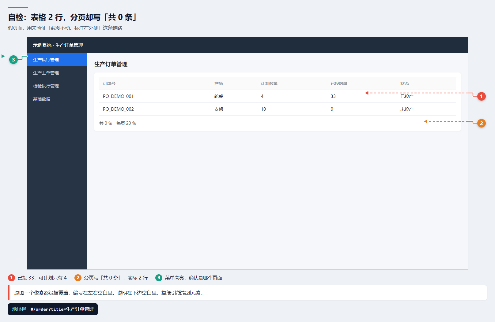
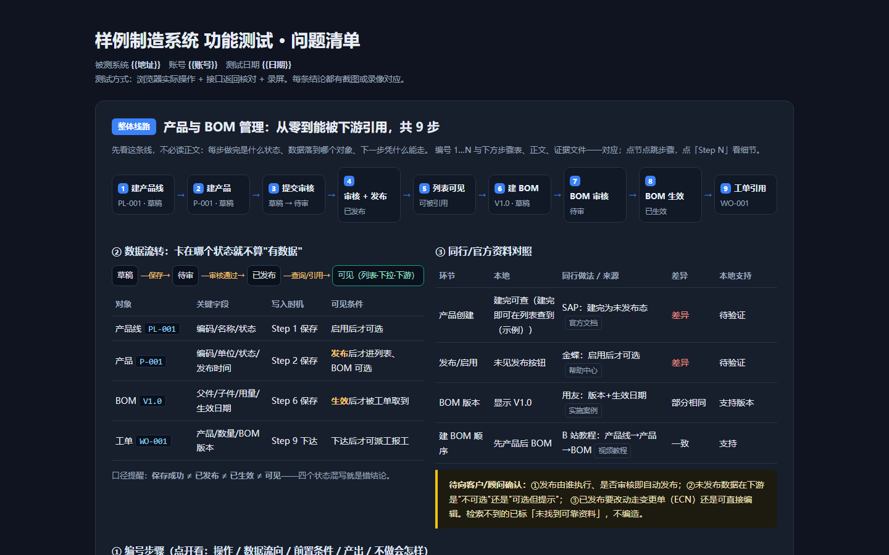

# dextestweb

[GitHub](https://github.com/yyxc-cc/dextestweb) · [在线说明页](https://yyxc-cc.github.io/dextestweb/) · [下载 ZIP](https://github.com/yyxc-cc/dextestweb/releases/tag/v1.0.0)

**给不拥有这个系统的测试者的 Agent Skill。**
从"登录、摸模块"到"标注截图 + 缺陷当场的演示视频 + 单文件报告"，全流程有脚本、有模板、有反误判清单；另附工业/MOM 业务课，不懂车间也能判断"数对不对"。

> 适用场景：你被叫去测一个别人的 Web 系统——没有源码、没有设计文档、可能没有数据库权限，
> 但你要给出"哪里有问题、怎么复现、有什么证据"的结论。



<sub>↑ `scripts/selftest.js` 生成的示例截图：原图一个像素都没被覆盖，编号在左右空白里，说明在下边空白里，细引线指到元素。</sub>

---

## 为什么需要它

外测最容易翻车的不是漏测，而是**误判**：

| 常见误判 | 真相 | 本技能的对策 |
|---|---|---|
| 点完菜单页面空白 → "这个功能没做" | 只是加载了 4~18 秒 | 等待条件绑定目标元素；慢记为性能问题 |
| 列表"共 0 条" → "这模块没数据" | 行数 > 0，分页 total 没接 | 行数 vs 分页 vs 接口 total 三方对照 |
| 某筛选下为空 → "检验录不进去" | 默认筛选本来就是空的 | 逐个筛选跑一遍再定性 |
| 保存报错但页面变了 → 没注意 | 前端已改、后端没回滚 | 数值变化序列 + 明细表回查 |
| 只截一张图 → 对方说"复现不了" | 缺 URL/上下文/数值 | 标注图含地址栏、菜单、分页、数值序列 |

---

## 安装

任选一个位置放 `dextestweb/` 目录（保持 `SKILL.md` 在根）：

```bash
# OpenCode（全局，推荐）
git clone <本仓库地址> ~/.config/opencode/skills/dextestweb

# 或手动拷贝
# Windows: %USERPROFILE%\.config\opencode\skills\dextestweb\
# 项目级: <项目>/.opencode/skills/dextestweb/
# Claude 兼容: ~/.claude/skills/dextestweb/  （或 .agents/skills/）
```

目录名必须与 `SKILL.md` 里的 `name` 一致（`dextestweb`）。

依赖（按需装，只有跑脚本时才需要）：

```bash
npm i playwright
npx playwright install chromium
# ffmpeg 用于切片/GIF：https://ffmpeg.org/download.html
```

---

## 快速开始

```bash
cp templates/config.example.json config.json     # 填账号、登录选择器、菜单容器
node scripts/census.js --config config.json      # 1) 摸骨架：菜单/URL/行数/分页 → census.json
node scripts/snap.js --config config.json --url "<页面URL>" --tab "综合查询" --expect-tab "综合查询" --verbose
                                                 # 2) 单页元素清单：页签/按钮(分级)/字段/列/分页/树
node scripts/probe.js  --config config.json --url "<页面URL>" --expect-tab "CT" --filters "未接收,检验中"
                                                 # 3) 单页取证：先过页面身份闸门，再逐个筛选
node scripts/selftest.js                         # 4) 先跑自检，确认标注/打包链路可用
```

登录态默认缓存在 `.auth/<host>.json`，第二次起免登录；换账号或缓存失效加 `--fresh`。

然后按 `SKILL.md` 的第 4~6 步出图、切片、打包。

**不认识的模块先别开测**：按 `references/09-process-discovery.md` 的五步法（功能定位 → 外部取证 → 同行对照 → 数据流转 → 从零编号步骤）先画出线路图。报告的**首屏**按 `templates/report.html` 的 `#route` 区块放三块——整体线路 / 数据流转与状态门槛 / 同行对照；编号与正文步骤、证据文件名一致。

首屏实际效果（示例数据全为占位）：



**发现 bug 就出片**：复制 `templates/demo-script.js`，把中间的操作换成你的，`demo.mark()` 打在动作之前，收尾自动切出 `mp4 + 封面 + gif`；视频上方会自动加一条留白标题条（标题=标记名），画面零遮挡。

---

## 内容

```
dextestweb/
├─ SKILL.md                  ← 主技能（流程、规矩、自检清单、反模式表）
├─ references/
│  ├─ 01-recon.md            ← 没有文档怎么摸清系统（菜单/接口/四个数）
│  ├─ 02-evidence.md         ← 双证据、三查法、五类高频问题的验证脚本
│  ├─ 03-packaging.md        ← 交付结构、单文件 HTML、Windows 中文路径坑
│  ├─ 04-industry.md         ← 工业业务课：系统版图/订单主线/12 对象/10 条不变量/术语表
│  ├─ 05-mom-checks.md       ← MOM 只读快检表：一页一页照着对
│  ├─ 06-runbook.md          ← 流程提示 runbook：A0~A8 的输入/产出/完成判据/闸门 + 可复制提示词
│  ├─ 07-onboarding.md       ← 新人上手：90 分钟路径、最小示例、产物验收表、卡点清单
│  ├─ 08-manufacturing-prompts.md ← 工艺生产企业管理流程提示：10 个环节的问/查/漏 + 模板
│  └─ 09-process-discovery.md ← 流程逆向梳理五步法：定位→取证→对照→流转→编号（含隐性前置条件）
├─ scripts/
│  ├─ lib/annotate.js        ← 干净截图 + 四周留白排版（编号/引线/图例/说明/地址栏），原图零覆盖
│  ├─ lib/demo.js            ← 缺陷视频：打标记 → 自动切片 mp4 + 封面 + GIF
│  ├─ lib/session.js         ← 登录态缓存、页面身份校验、快照、失败请求收集、videoStart
│  ├─ lib/snap.js            ← 元素清单核心（页签/按钮分级/字段/列/分页/弹窗/树 + diff）
│  ├─ census.js              ← 遍历菜单产出 census.json
│  ├─ snap.js                ← 单页元素清单 CLI（--tab / --diff / --fail-on-change）
│  ├─ probe.js               ← 单页取证（逐个筛选、行数/分页对照）
│  ├─ clip.js                ← ffmpeg：切片 / GIF / 抽帧 / 联络表
│  ├─ pack.js                ← 单文件 HTML（资源内嵌，含视频/poster）+ PDF
│  ├─ md2html.js             ← 报告 md → html，给 pack.js 吃
│  └─ selftest.js            ← 不需要被测系统的端到端自检
└─ templates/
   ├─ config.example.json
   ├─ demo-script.js         ← 缺陷视频演示脚本模板
   ├─ issue.md               ← 单个缺陷记录模板
   └─ report.html            ← 报告页面模板（深色卡片 + 截图 + 视频）
```

---

## 五个关键设计

1. **双证据**：页面 + 接口/地址栏/库，缺一条只能写"疑似"。
2. **等待目标，不等待时间**：所有判断都基于"目标内容已出现"，从根上避免"慢=没做"。
3. **截图不动**：先在四周加空白再标注——编号在左右边距、说明在下边距、虚线引线指过去。原图一个像素都不覆盖，对方才能拿它核对。
4. **交付单文件**：中文相对路径在很多查看器里打不开，报告必须能 base64 内嵌、双击即看，并附带 PDF 兜底。
5. **首屏先讲走法**：报告标题之下第一屏就是「整体线路 / 数据流转与状态门槛 / 同行对照」，新人不读正文也知道按什么顺序做、数据去哪、同行怎么干。

---

## 更新

**1.4.0** — 流程提示、新人上手、制造管理流程提示、流程逆向梳理、报告首屏

- 新增 `references/06-runbook.md`：A0~A8 九个阶段，每阶段固定「输入 / 动作 / 产出 / 完成判据 / 闸门」，附可复制提示词与一页行动卡。
- 新增 `references/07-onboarding.md`：新人 90 分钟两条路径（先跑 selftest 再测真系统）、最小可跑通示例、产物验收表、13 条卡点自查清单、第一天合格线。
- 新增 `references/08-manufacturing-prompts.md`：工艺路线、BOM、工单下达、领料投料、报工在制、质检不合格品、ECN、设备工装、委外、成本归集，每环节「该问客户什么 / 该核对什么 / 容易漏什么」+ 提示模板 + 跨环节串联校验。
- 新增 `references/09-process-discovery.md`：流程逆向梳理五步法（功能定位 → 外部取证 ≥3 类来源 → 同行对照 → 数据流转还原 → 从零编号步骤）、隐性前置条件「症状→原因→验证」三列表、端到端示例与编号流程图、反"瞎提示"四条纪律。
- `SKILL.md` 新增「流程逆向梳理」「流程总览」「产出规范：HTML 首屏」三节，自检清单补首屏与编号一致性检查。
- `templates/report.html` 新增首屏 `#route` 区块：① 编号线路图（节点可点开看细节）② 数据流转与状态门槛图 ③ 同行对照表（带来源类型与差异标记），沿用原有深色配色。
- `scripts/md2html.js` 支持 `<!--RAW--> … <!--/RAW-->` 原样输出，md 流程也能放首屏自定义 HTML。

**1.3.0** — 缺陷视频"当场出片" + 工业业务层

- 新增 `lib/demo.js`：全程录像 → `demo.mark()` 打点 → `finishDemo()` 自动切片出 `mp4 + 封面 + gif`，多个缺陷一次切完，编号自动递增。
- 视频默认在画面上方加**留白标题条**（标题=标记名、备注=副标题），画面一个像素不遮挡；颜色语义跟截图一致（红缺陷/橙待确认/绿正常），`caption:false` 可关。
- 时间轴校准：实测录像时间轴是线性的，偏差只在"开录晚几秒"，用 `结束墙钟 − 视频时长` 反推即可；切点越界会被夹取并告警，不再悄悄产出空文件。
- `md2html.js` 支持 `` → 带控件 `<video>`，同名 `-封面.jpg` 自动挂 poster；`pack.js` 把视频 base64 内嵌进单文件 HTML（断网可播）。
- 新增 `snap.js` + `lib/snap.js`：一页的页签/按钮（按 mutate/reset/read 分级）/字段/列/分页/弹窗/树全部列清，元素自带 annotate 可用的选择器；`--diff` 做结构回归，`--fail-on-change` 退出码 4。
- 新增 `references/04-industry.md`：ERP/PLM/MOM/WMS/QMS/SCADA 版图、一张订单的完整旅程、MOM 12 个核心对象、10 条硬不变量、9 类行业特有缺陷、小白提问清单、术语表。
- 新增 `templates/demo-script.js`：缺陷视频脚本模板，改三处就能跑。

**1.2.0** — 核对规则 + 打包链路

- 页面身份闸门 `expectPage()`：页签文字对不上就抛异常 + 截图，读数直接作废。
- 新增 `md2html.js`，报告统一走 md → html → pack.js。
- 标注新增 `frame`/`arrow`/`side` 选项，宽容器自动改指内部文字。

**1.1.1** — 用假 MOM 系统实跑后修的三个真问题

- 引线坐标少了图片留白偏移，箭头整体偏左 88px，会指到旁边的侧边栏上（现在箭头落点与元素边缘完全对齐）。
- 分页条这类"宽容器"改成指它里面的文字：元素宽度超过文字 3 倍时自动改用文字矩形，箭头停在文字外侧 2px，不再指向右边一大片空白。
- 目标元素在视口外时先自动滚进来；滚不进来就报 `offscreen` 并跳过，绝不画一条指向空白的引线。
- 录屏尺寸改成跟随视口比例，不再写死 1280×800（否则黑边 + 画面压扁）。
- 有标注被跳过时自动重新编号，不会出现 ①②④ 断号。

**1.1.0** — 标注改为"截图不动、四周留白"

- `lib/annotate.js` 重写：先截干净图 → 量元素矩形 → 在空白画布里排版 → 再截一次。
- 新增左右边距（`gutter`，默认 88px）、下方图例、`label`/`color`/`side`/`frame`/`arrow` 字段。
- 引线：边距里实线、画面内虚线，进入点在元素上内边距，不压同行文字；同一行多个标注自动错开。
- 自检新增一项「原图未被裁」：断言输出宽度 = 原图宽 + 左右留白。

**1.0.0** — 首版：census / probe / clip / pack / selftest + 三个 references + 三个模板。

---

## 自检

```bash
node scripts/selftest.js
# ✓ 标注截图 / ✓ 单文件 HTML / ✓ 资源已内嵌 / ✓ PDF / ✓ 缺陷视频 / ✓ 视频已内嵌
```

自检不需要被测系统：脚本会造一个假页面，把「截图 → 边距标注 → 打标记切片 → 内嵌 → PDF」整条链路跑一遍。
没装 ffmpeg 会自动跳过视频那几项（`--no-video` 可强制跳过）。

---

## 许可

MIT。可自由用于商业项目，保留版权声明即可。
