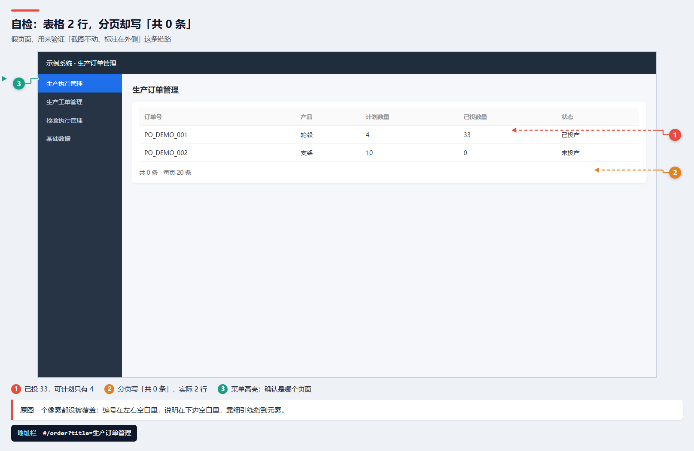

# dextestweb

[GitHub](https://github.com/yyxc-cc/dextestweb) · [在线说明页](https://yyxc-cc.github.io/dextestweb/) · [下载 ZIP](https://github.com/yyxc-cc/dextestweb/releases/tag/v1.0.0)

**给不拥有这个系统的测试者的 Agent Skill。**
从"登录、摸模块"到"标注截图 + 视频复现 + 单文件报告"，全流程有脚本、有模板、有反误判清单。

> 适用场景：你被叫去测一个别人的 Web 系统——没有源码、没有设计文档、可能没有数据库权限，
> 但你要给出"哪里有问题、怎么复现、有什么证据"的结论。



<sub>↑ `scripts/selftest.js` 生成的示例截图：原图一个像素都没被覆盖，编号在左右空白里，说明在下边空白里，细引线指到元素。</sub>

---

## 为什么需要它

外测最容易翻车的不是漏测，而是**误判**：

| 常见误判 | 真相 | 本技能的对策 |
|---|---|---|
| 点完菜单页面空白 → "这个功能没做" | 只是加载了 4~18 秒 | 等待条件绑定目标元素；慢记为性能问题 |
| 列表"共 0 条" → "这模块没数据" | 行数 > 0，分页 total 没接 | 行数 vs 分页 vs 接口 total 三方对照 |
| 某筛选下为空 → "检验录不进去" | 默认筛选本来就是空的 | 逐个筛选跑一遍再定性 |
| 保存报错但页面变了 → 没注意 | 前端已改、后端没回滚 | 数值变化序列 + 明细表回查 |
| 只截一张图 → 对方说"复现不了" | 缺 URL/上下文/数值 | 标注图含地址栏、菜单、分页、数值序列 |

---

## 安装

任选一个位置放 `dextestweb/` 目录（保持 `SKILL.md` 在根）：

```bash
# OpenCode（全局，推荐）
git clone <本仓库地址> ~/.config/opencode/skills/dextestweb

# 或手动拷贝
# Windows: %USERPROFILE%\.config\opencode\skills\dextestweb\
# 项目级: <项目>/.opencode/skills/dextestweb/
# Claude 兼容: ~/.claude/skills/dextestweb/  （或 .agents/skills/）
```

目录名必须与 `SKILL.md` 里的 `name` 一致（`dextestweb`）。

依赖（按需装，只有跑脚本时才需要）：

```bash
npm i playwright
npx playwright install chromium
# ffmpeg 用于切片/GIF：https://ffmpeg.org/download.html
```

---

## 快速开始

```bash
cp templates/config.example.json config.json     # 填账号、登录选择器、菜单容器
node scripts/census.js --config config.json      # 1) 摸骨架：菜单/URL/行数/分页 → census.json
node scripts/probe.js  --config config.json --url "<页面URL>" --filters "未接收,检验中"
                                                 # 2) 单页取证：逐个筛选确认
node scripts/selftest.js                         # 3) 先跑自检，确认标注/打包链路可用
```

然后按 `SKILL.md` 的第 4~6 步出图、切片、打包。

---

## 内容

```
dextestweb/
├─ SKILL.md                  ← 主技能（流程、规矩、自检清单、反模式表）
├─ references/
│  ├─ 01-recon.md            ← 没有文档怎么摸清系统（菜单/接口/四个数）
│  ├─ 02-evidence.md         ← 双证据、三查法、五类高频问题的验证脚本
│  └─ 03-packaging.md        ← 交付结构、单文件 HTML、Windows 中文路径坑
├─ scripts/
│  ├─ lib/annotate.js        ← 干净截图 + 四周留白排版（编号/引线/图例/说明/地址栏），原图零覆盖
│  ├─ lib/session.js         ← 登录、等待、快照、失败请求收集
│  ├─ census.js              ← 遍历菜单产出 census.json
│  ├─ probe.js               ← 单页取证（逐个筛选、行数/分页对照）
│  ├─ clip.js                ← ffmpeg：切片 / GIF / 抽帧 / 联络表
│  ├─ pack.js                ← 单文件 HTML（资源内嵌）+ PDF
│  └─ selftest.js            ← 不需要被测系统的端到端自检
└─ templates/
   ├─ config.example.json
   ├─ issue.md               ← 单个缺陷记录模板
   └─ report.html            ← 报告页面模板（深色卡片 + 截图 + 视频）
```

---

## 四个关键设计

1. **双证据**：页面 + 接口/地址栏/库，缺一条只能写"疑似"。
2. **等待目标，不等待时间**：所有判断都基于"目标内容已出现"，从根上避免"慢=没做"。
3. **截图不动**：先在四周加空白再标注——编号在左右边距、说明在下边距、虚线引线指过去。原图一个像素都不覆盖，对方才能拿它核对。
4. **交付单文件**：中文相对路径在很多查看器里打不开，报告必须能 base64 内嵌、双击即看，并附带 PDF 兜底。

---

## 更新

**1.1.0** — 标注改为"截图不动、四周留白"

- `lib/annotate.js` 重写：先截干净图 → 量元素矩形 → 在空白画布里排版 → 再截一次。
- 新增左右边距（`gutter`，默认 88px）、下方图例、`label`/`color`/`side`/`frame`/`arrow` 字段。
- 引线：边距里实线、画面内虚线，进入点在元素上内边距，不压同行文字；同一行多个标注自动错开。
- 自检新增一项「原图未被裁」：断言输出宽度 = 原图宽 + 左右留白。

**1.0.0** — 首版：census / probe / clip / pack / selftest + 三个 references + 三个模板。

---

## 自检

```bash
node scripts/selftest.js
# ✓ 标注截图 / ✓ 单文件 HTML / ✓ 资源已内嵌 / ✓ PDF
```

自检产物在系统临时目录 `dextestweb-selftest/`，可以直接打开看效果。

---

## 许可

MIT。可自由用于商业项目，保留版权声明即可。
