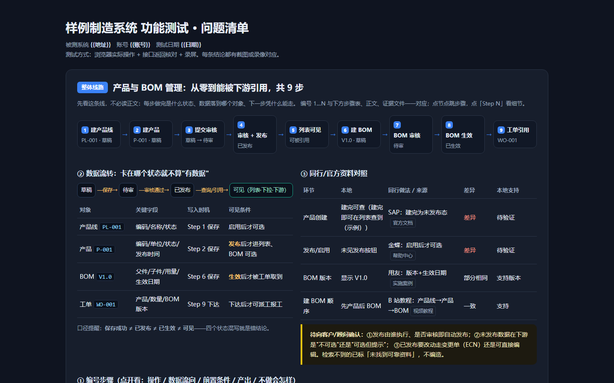

# dextestweb · 不拥有系统的人，怎么把它测明白

## 这套技能解决什么问题

你被叫去"测一下这个系统有什么问题"。你不是产品方，没有设计文档，可能连数据库权限都没有，出了问题还要被问"你确定吗"。

**真正的风险不是漏测，而是误判。** 常见翻车方式：

- 页面加载慢 6 秒 → 判成"这个功能没做"
- 默认筛选是空的 → 判成"整个模块没数据"
- 点击菜单后还显示上一页 → 判成"六个菜单是同一个页面"
- 只截了一张图，没有地址栏/接口/数值变化 → 对方一句"我这儿复现不了"就推翻了

本技能用一套固定流程把这些坑堵住：**先摸骨架，再逐页取证，每个结论至少两种证据，最后用标注图和视频把它钉死。**

如果你的对象是工厂系统（MES / MOM / ERP / WMS），先花 20 分钟读 [`references/04-industry.md`](references/04-industry.md)：**ERP 管该不该做，MOM 管怎么做完，WMS 管料在哪，QMS 管能不能放行**；后面有 10 条硬不变量和一张术语表，看到不懂的字段直接查。开测时把 [`references/05-mom-checks.md`](references/05-mom-checks.md) 摊在旁边，一页一页照着对。不懂业务时，你只能测"按钮能不能点"；懂一点业务，你才能测"数对不对"。

测具体环节（工艺路线、BOM、工单下达、委外、成本归集）时，把 [`references/08-manufacturing-prompts.md`](references/08-manufacturing-prompts.md) 的提示模板摊在旁边，一段一段对。遇到**不认识的模块**，不要直接开测——先按下一节的五步法把它拆明白。

---

## 第一次用：先选路径

| 你的状态 | 做什么 | 读哪篇 |
|---|---|---|
| 环境还没跑通 | 先跑 `node scripts/selftest.js`（不需要被测系统），再造 `config.json` 登录一次 | [`references/07-onboarding.md`](references/07-onboarding.md) |
| 环境通了，不知道下一步干什么 | 按 A0→A8 九个阶段走，每阶段只看输入 / 产出 / 闸门 | [`references/06-runbook.md`](references/06-runbook.md) |
| 面对一个不认识的模块 | 先做"功能定位 → 外部取证 → 同行对照 → 数据流转 → 编号步骤"五步 | 本文下一节 + [`references/09-process-discovery.md`](references/09-process-discovery.md) |
| 要测工艺/工单/委外/成本这类业务流程 | 找到对应环节，复制提示模板，填占位值 | [`references/08-manufacturing-prompts.md`](references/08-manufacturing-prompts.md) |

新人第一天的合格线是"做出来"，不是"测得好"：一张留白标注图 + 一条双证据缺陷 + 一份断网能看的单文件报告，三样齐了就算上手。

---

## 边界：开始之前先写下来

1. **只读优先。** 需要写数据（建单、建码、提交）必须用户明确同意；同意后，写之前记录"写入前快照"（单号 / id / 关键字段值），结束时能逐条报出来，并给出清理建议。
2. **不测用户说不用的模块。** 他找不到入口、或明确说"这个不归我管"，就跳过，并在报告里写"未覆盖 + 原因"。不要自己找页面替客户扩大范围。
3. **不设计、不改需求。** 你的产出是"现状 + 问题 + 证据"，不是"应该怎么做一套"。建议只写修复方向，一句话即可。
4. **每个结论至少两种证据。** 页面截图 + 接口返回 / 地址栏 / 网络记录 / 数据库。只有一种证据时，措辞必须是"疑似"。

---

## 流程逆向梳理：不认识的模块，先按五步走

> 你不在这个行业里，"凭经验提示"十次有九次是错的。任何流程结论只有两种合法来源：**外部资料**（官方文档 / 视频教程 / 同行产品 / 实施案例）或**系统内证据**（字段、状态、接口、日志）。两者都没有，只能写"待验证"。

| 步 | 做什么 | 产出 | 完成判据 |
|---|---|---|---|
| 1 功能定位 | 取菜单路径、页面标题、按钮；写一句话定位 + 角色 + 边界 | 《功能定位》 | 能说出"它**不负责**什么" |
| 2 外部取证 | 拿功能名去官方文档、B 站/抖音教程、CSDN/知乎、厂商实施案例、同行产品（用友/金蝶/SAP 同类模块）检索 | 来源记录表 | **≥ 3 类来源交叉印证** |
| 3 同行对照 | 比字段叫法、必填约束、审批环节、状态机、版本与变更 | 相同点 / 差异点表 | 每个差异都标"本地是否支持" |
| 4 数据流转还原 | 谁创建 → 落到哪个对象/表 → 什么状态 → 什么动作才对外可见 → 谁依赖 | 流转图 + 状态门槛表 | 能画出"创建→发布→可见"完整链 |
| 5 从零编号步骤 | Step 1…N，每步写输入 / 操作 / 状态变化 / 不做会怎样 | 编号步骤表 + 线路图 | 编号与流程图节点**一一对应** |

四条硬纪律（完整版见 [`references/09-process-discovery.md`](references/09-process-discovery.md)）：

1. **结论必须可溯源**：指到外部来源，或指到页面字段/状态/接口证据；两者都没有 → 写"待验证"，不许写肯定句。
2. **检索不到就明说"未找到可靠资料"**，并给出《待确认问题清单》；不许编造行业惯例。
3. **同名先统一口径**（产品 vs 物料、BOM vs 配方、发布 vs 生效），报告开头先定义本文口径。
4. **"保存成功 ≠ 已发布 ≠ 已生效 ≠ 可见"**——这四件事通常是四个不同状态，混着写就是错结论。

隐性前置条件（最容易漏，完整"症状 → 真实原因 → 验证方法"表在 09 第 3 节）：草稿必须发布/启用才进正式库、才出现在列表；下拉框只列已发布数据；建 BOM 前必须先有产品线 / 物料 / 计量单位；界面上没标 `*` 但保存才报必填；权限与组织维度造成"看不到"而不是"没数据"；已发布数据要靠变更单（ECN）才能改。

---

## 流程总览：九个阶段，五道闸门

`SKILL.md` 下面的第 0~7 步是"做法"，九个阶段的输入 / 产出 / 完成判据见 [`references/06-runbook.md`](references/06-runbook.md)。赶时间只看这张表：

| 阶段 | 产出（必须是磁盘上的文件） | 闸门（必须停下来问人） |
|---|---|---|
| A0 立项 | `00-边界.md` | 客户说不出"不能点什么" / 只有生产环境 |
| A1 环境 | `config.json`、`.auth/` | 登录有验证码 / 只给管理员账号 |
| A2 摸骨架 | `census.json` | 要求选组织/仓库 / 单页加载超 60 秒 |
| A3 排优先级 | `01-页清单.md` | 客户要求"全测"但时间不够 |
| A4 逐页取证 | `snap-*.json`、读数表 | 页面读数与接口冲突 / 需要写权限 |
| A5 定级复核 | `02-候选缺陷.md` | 规则依赖客户特例 / 可能是上游没传 |
| A6 出图出片 | `*.png`、`*.mp4`、`*.gif` | 截图缺上下文 / 涉及客户真实数据 |
| A7 打包 | 单文件 HTML + PDF | 有测试数据清不掉 |
| A8 自检交付 | 回执 + 未覆盖清单 | 出现"我以为"但没证据的结论 |

**任何一步没有产出文件，就等于没做完。** 这条比"读了多少页"重要。

---

## 第 0 步：准备（10 分钟）

| 事项 | 做法 |
|---|---|
| 业务预习 | 工厂系统先读 `references/04-industry.md`（概念）和 `05-mom-checks.md`（逐页检查点）。不知道"投入=合格+报废+在制"，就只能测按钮 |
| 流程预习 | 不认识这个模块，先走五步法（`references/09-process-discovery.md`）：定位 → 外部取证 → 同行对照 → 数据流转 → 编号步骤。**没有线路图就开测，后面全是猜** |
| 交付目录 | 先建好，用编号排序：`01-P0-xxx/`、`02-P1-xxx/`、`06-模块实况/` |
| 登录态 | 首次登录后缓存到 `.auth/<host>.json`（`storageState`），后面所有脚本免登录。换账号、权限测试、或缓存失效时加 `--fresh` 重登。**别让每个脚本都重登一遍**——慢系统上这是最大的时间黑洞，也是撞后端抽风的主要来源 |
| 浏览器 | Playwright + Chromium，viewport 1600×1000（截图清晰、表格列不挤） |
| 录屏 | `context.recordVideo`，尺寸自动跟视口等比（`lib/session.js` 已处理）。**时间轴是线性的，静止不会压缩**；唯一偏差是"开录比页面创建晚几秒"，收尾时用 `结束墙钟 − 视频时长` 反推即可（`lib/demo.js` 已做，无需手工对时） |
| 视频处理 | 确认 `ffmpeg` 可用（`ffmpeg -version`）；`ffprobe` 常常没有，`demo.js` 会退化成读 `ffmpeg -i` 的 Duration |
| 缺陷视频 | 想要"一发现 bug 就有片"，用 `lib/demo.js`：全程录 → `demo.mark()` 打点 → `finishDemo()` 自动切片出 mp4 + 封面 + GIF（见第 5 步） |
| 中文路径 | 一律用 Node `fs` 或编辑器写文件；**不要用 PowerShell 拼中文路径和中文输出**（会乱码/截断） |

先把"登录 → 截图"跑通，再往下走。登录选择器写进 `config.json`，不要硬编码在十几个脚本里。

---

## 第 1 步：摸清骨架（只读）

目标：拿到一张"菜单 → 路由 → 页面 → 数据量"的表，后面所有判断都靠它。

1. **登录后截一张全景图**，确认菜单层级。
2. **抓接口**：`page.on('response')` 收集所有 `/api/` 响应，重点记 4xx/5xx 和分页接口的 `totalElements`。
3. **遍历菜单**：取侧边栏文本 → 点击 → 等目标内容出现 → 记 URL。
4. **每页四个数**：表格行数、分页文案（只统计**可见**的 `.el-pagination`）、标签页、工具按钮。
5. **每页一个指纹**：`hash + 激活页签 + 菜单高亮 + 文本长度`。这四样都没变却换了菜单 → 点击没生效，这一页的数不能信。

> 这四组数就是后面的"照妖镜"：页面 5 行却写"共 0 条"、接口 20 条却页面空白，都是在这一步暴露的。

用 `scripts/census.js` 跑第一遍，输出 `census.json`。**这一步不点任何新增/保存按钮。**

---

## 第 2 步：逐页验证（最容易翻车）

**等待条件必须是"目标内容出现"，不是固定 sleep。**

```js
// ❌ 会骗你
await page.click('text=生产工单管理');
await page.waitForTimeout(6000);
const rows = await page.locator('tbody tr').count();   // 可能还是上一页的 20 行

// ✅ 等目标页的特征出现
await page.click('text=生产工单管理');
await page.waitForFunction(() =>
  [...document.querySelectorAll('.el-tabs__item')].some(e => e.innerText.includes('返修')),
  null, { timeout: 60000 }
);
```

判断"这页是空的"之前，按顺序排除：

0. **页面身份对不对？**（激活页签、URL、菜单高亮，见下）
1. 有没有 loading 遮罩 / 骨架屏 / 小转圈？（有 → 还没加载完，继续等）
2. 分页 total 是多少？（`共 0 条` + 表格有行 = 分页 bug，不是没数据）
3. 换个筛选条件试试（未接收 → 检验中 → 已处理）
4. 直接看接口返回（有 20 条 → 前端问题）
5. 刷新重进一次（排除缓存/路由残留）

**慢 ≠ 没做。** 慢要写成性能问题（附实测秒数），不要写成"功能缺失"。

**任何"看起来没实现"的结论，必须再等 30 秒 + 刷新重进一次，才能写进报告。**

### 读数之前，先确认"我现在在哪一页"

点页签经常不生效（Element UI 的 `.el-tabs__item` 点了没切，或者同名按钮落在隐藏页签里）。**这是黑盒测试最贵的误判**：你会把射线页签的数据，当成 CT 页签的结论写进报告，而且看起来一切正常。

```js
const { expectPage, snapshot } = require('./lib/session');

// 闸门：文字对不上就抛异常 + 截图，本次读数直接作废
await expectPage(page, cfg, { tab: 'CT', hash: '/page/xxx', text: '试验项目' });
const snap = await snapshot(page, cfg);      // 过了闸门才允许读数
```

规则：

- 带页签的页面，`probe.js --expect-tab "CT"` 是**必填**，不是可选项。
- 报告里的每个读数都要带 `activeTab`；出问题时第一眼能分清"系统错了"还是"我们读错页了"。
- 点页签后自己校验 `.el-tabs__item.is-active` 的文字，不要假设"点了就切了"。同名按钮（工具栏里的"生成报告"）可能先在隐藏页签里被命中，用 `:visible` 还不够，要连页签一起限定。

---

## 第 3 步：缺陷取证（一次做对，别返工）

每个缺陷固定记录这几项：

```
编号 / 级别（P0-P3）/ 页面 + URL / 前置数据（单号、id、关键字段）
步骤（能照着重放）/ 期望 / 实际 / 证据（截图编号 + 视频时间点）
影响（对现场意味着什么）/ 修复方向（一句话）
```

### 先把页面"数清楚"：snap 清单

凭眼睛看会漏。先让脚本把这一页的**页签 / 工具栏 / 字段 / 列 / 行数 / 分页 / 弹窗 / 分类树**全列出来，每个元素都带一个能直接给 `annotate.js` 用的选择器：

```bash
node scripts/snap.js --config config.json --url "<页面URL>" \
  --tab "综合查询" --expect-tab "综合查询" \
  --wait 6000 --verbose --json snap-adv.json
```

输出直接告诉你三件事：

- **能点但会改数据的按钮**（新建/导入/修改/作废）——只读测试**不要点**；
- **"重置/清空"类按钮**——这类按钮是"只清 UI 不重查"的高发区，看到就先怀疑；
- **表单字段 vs 表格列**——新建弹窗少一个关键字段（比如没有"物料编号"），只有列清单才能一眼看出来。

想证明"这次改完真的没影响别的地方"，把改动前后各存一份，跑结构比对：

```bash
node scripts/snap.js ... --json before.json
# …（改配置 / 换版本 / 再点一遍）…
node scripts/snap.js ... --diff before.json --fail-on-change
# 退出码 4 = 结构变了；CI/回归里可以直接当门禁
```

> 读数的前提仍然是**身份闸门**：`--expect-tab` 对不上，`snap.js` 退出码 2 并截图，绝不继续读数。

### 三条经验

- **截图要有定位上下文**：地址栏、菜单高亮、目标行、分页文案，缺一个对方就能说"这不是那个页面"。
- **数值类缺陷给变化序列**：`1→9→13→17…` 比一张静态截图强十倍，能证明"每次操作都累加"。
- **级别按后果定，不按心情定**：P0 = 数据错/丢/不可恢复；P1 = 主流程走不通；P2 = 显示错/体验差；P3 = 文案。

---

## 第 4 步：标注截图（截图不动，标注在四周空白）

不要用画图软件手工画框——位置会错、返工量大。

**更重要的原则：标注不许盖在画面上。** 红框压在表格上，会挡住它要证明的那行字；标题条压在顶部，会挡住菜单和面包屑。客户看到的是"被涂改过的图"，说服力反而下降。

正确做法：**先截一张干净图（一个像素都不改），再在图片四周加空白，把编号放边距、说明放下边、用细引线指过去。**

```
┌──────────────────────────────────────────┐
│ ▍结论标题                                  │  ← 上边距
│   补充说明（单号、数值）                     │
├────┬────────────────────────────┬────────┤
│ ①  │                            │   ②    │  ← 左右边距：编号
│  └─▶│     原始截图，完全未被覆盖    │◀──┘   │     引线从外侧进入
├────┴────────────────────────────┴────────┤
│ ① 计划数量 = 4   ② 已投 33（超计划 29）      │  ← 下边距：图例
│ 说明 / 证据面板 / 地址栏                     │
└──────────────────────────────────────────┘
```

```js
const { shot } = require('./scripts/lib/annotate');

await shot(page, '01-计划4件已投33件.png', {
  title: '物料建码：计划 4 件，已投数量 33 件',
  sub: '订单 PO_xxx（轮毂）· 只发出 1 件货',
  accent: '#e74c3c',                    // 红=缺陷，橙=待确认，绿=正常对照
  gutter: 88,                           // 左右留白（编号放这里）
  boxes: [
    { dialogCol: '计划数量', row: 0, label: '计划数量 = 4',        color: '#e67e22' },
    { dialogCol: '已投数量', row: 0, label: '已投 33（超计划 29）', color: '#e74c3c' }
  ],
  url: page.url(),                      // 传 true 则自动取当前地址
  note: '这个数是 7 次"保存被拦截"累加出来的，编码一条都没写进去。'
});
```

规则：

- **一张图只讲一件事**，编号 ①②③ 按**你的操作顺序**排（不是按页面上下位置）——所以别人照着图就能重放。
- 标注落在**具体元素**上（某个单元格、某个按钮、某条分页文案），不要框整行、整页。"这行有问题"没人能修；"这一列的 33 有问题"才是缺陷。
- 元素找不到、或者整个在视口外滚不进来时，脚本会打印 `missed` 并说明原因（`notfound` / `hidden` / `offscreen`），**不会画一条指向空白的线**。
- 颜色语义固定：红缺陷 / 橙待确认 / 绿正常（正常对照也要拍，客户才知道"哪些是好的"）。
- 引线：边距里是实线，进画面后变虚线（读者一眼能分出"这是标注，不是界面元素"）。进入点取元素上部 1/4 处（最多 12px），矮元素（按钮）贴着顶边，横穿时压的是内边距不是文字；箭头往元素里探 16px，避免"停在边界上分不清指哪一列"。
- **指文字优先于指容器**：分页条、工具栏这种宽容器，真正的证据是里面那行字。元素宽度超过文字宽度 3 倍时，自动改用文字矩形，箭头停在文字外侧 2px——一个字都不盖，也不会指向右边那一大片空白。
- 同一行有多个标注时，脚本会自动上下错开 7px，不会叠成一条线。
- 想更醒目再给元素描外框：`frame: true`（框画在元素外侧，不进内容）。
- 只需要编号、不想要引线：`arrow: false`。

> 一句话验收：**把标注全遮掉，原图还能当证据用；把原图遮掉，标注还能读懂。** 两条都成立才算合格。

---

## 第 5 步：视频演示（发现 bug 就出片）

**目标：发现缺陷的那一下，就已经有了能直接发群的短视频。** 不补录、不拖时间轴。

原理只有三句：

1. 整个走查从打开浏览器就开始录（`openSession(cfg, { videoDir })`）；
2. 每发现一个缺陷，在**动作发生之前**打一个标记 `demo.mark('重置不重查')`；
3. 收尾 `finishDemo()` 按标记前后各留几秒自动切片，出 `mp4 + 封面.jpg + gif`。

为什么必须"先录后切"：缺陷是走查中撞见的，事先不知道哪一秒会发生；事后补录会丢掉"操作前"的状态，说服力少一半。

```js
const { loadConfig, openSession, gotoPage, expectPage } = require('./scripts/lib/session');
const { createDemo, finishDemo } = require('./scripts/lib/demo');

const s = await openSession(cfg, { videoDir: 'tmp/rec' });
const demo = createDemo(s.page, s.videoStart);      // t0 = 页面创建时刻

// …走到可疑的地方，先取"操作前"读数…
demo.mark('重置只清条件不重查', '条件清空、列表仍是 1 条、0 个请求');
await page.locator('button', { hasText: '重置' }).click();
// …取"操作后"读数…

const res = await finishDemo({
  page: s.page, ctx: s.ctx, demo,
  outDir: '交付目录',
  pre: 9, post: 8,        // 前 9 秒（看得到操作前）、后 8 秒（看得到结果稳定）
  gif: true
});
// → 01-重置只清条件不重查.mp4 / -封面.jpg / .gif
```

要点：

- **标记打在动作前**，不是动作后。`pre` 那几秒就是"操作前状态"的证据。
- 一次走查可以打多个标记，收尾一次性切完，编号自动递增（`01-`、`02-`…）。
- **标题条**：默认会在画面上方加一条 70px 左右的留白标题条（标题=标记名，副标题=备注），画面一个像素都不遮挡——和截图"标注在留白里"是同一条原则。不想要就 `caption: false`。
- 颜色语义跟截图一致：`demo.mark('…', '…', { color: '#e67e22' })` 橙色=待确认、`#16a085` 绿色=正常对照。
- 切片自带自检：片段明显短于预期会告警（说明标记点超出了录像范围），不会悄悄交一个黑屏。
- 封面取"结果已经稳定"的那一帧（片段结束前 2.5 秒），不是点击那一瞬；封面也带标题条，发出去单看一张图也能读懂。
- 报告里就写一行：``。`md2html.js` 会转成带控件的 `<video>`，同名 `-封面.jpg` 自动挂成 poster，`pack.js` 把它 base64 内嵌进单文件 HTML。
- 视频里最好有一句"看什么"：切片前后各留的几秒，就是让观众自己看到"变了 / 没变"。

**手工切片**（已经有录像、只想补一段）仍用 `scripts/clip.js`：

- 切点：动作前 2 秒开始，结果出现后再留 3~5 秒。
- 先用 `clip.js sheet` 出联络表（`--times 0,2,4,6,8`）确认时间轴，比反复试切快得多。
- GIF 用两遍调色板；`palettegen` 必须加 `-frames:v 1`，否则报 "Could not get frame filename number 2"。
- GIF > 3 MB 就降规格：`crop` 掉无关区域 + `fps 7` + 宽 760，通常能从 9 MB 降到 500 KB。

---

## 第 6 步：打包交付

目录长这样（编号决定阅读顺序）：

```
交付包/
├─ 00-问题清单-单文件.html   ← 主入口，图片/视频全内嵌
├─ 302MOM-问题清单.pdf       ← 发人/打印版
├─ 00-问题清单.md            ← 纯文字版，方便贴群/贴文档
├─ 01-重置只清条件不重查.mp4  ← 缺陷视频（自动切）
├─ 01-重置只清条件不重查-封面.jpg
├─ 01-重置只清条件不重查.gif  ← 会动的缩略图，贴群/邮件预览
├─ 完整演示录像.mp4
├─ 01-P0-xxx/  01-….png 02-….png 复现全过程.mp4 关键片段.gif
├─ 02-P1-xxx/  …
└─ 06-模块实况对照/           ← 正常模块的实拍，证明"这些是有的"
```

**必须做单文件版。** 带中文文件名的相对路径，在很多查看器（包括各类预览面板）里会解析失败，用户只会看到"图片打不开"。把资源 base64 内嵌，一个文件走天下。

用 `scripts/pack.js` 一键生成单文件 HTML + PDF（PDF 用打印样式：单列图片、隐藏视频）。视频会以 base64 内嵌，**单文件 HTML 里能直接播**；同名 `-封面.jpg` 会被挂成 poster，没点播放时也不是黑块。

报告是 md 写的，先过一道 `scripts/md2html.js` 再打包：`node scripts/md2html.js 报告.md` → `node scripts/pack.js --html 报告.html --name "客户-模块"`。md 里用 `` 插图、`` 插视频，pack.js 才会把它内嵌。

---

## 产出规范：HTML 首屏必须先讲"整条路怎么走"

> 客户和新人打开报告，第一眼该看到的是**整条线路、数据去哪、同行怎么干**，而不是一堆缺陷。
> 因此：**标题之下、正文之前，三块齐备；首屏能脱离正文独立读懂。**

| 区块 | 内容 | 硬要求 |
|---|---|---|
| ① 整体线路 | 编号节点 1…N（每步一个操作动作），用箭头/连线串成一条路线（横向时间轴或纵向均可） | 编号与正文步骤表、证据文件前缀（`01-`、`02-`…）**一一对应**；每步可点开（`<details>`）或锚点到步骤表，看到「操作 / 数据流向 / 前置条件 / 产出」 |
| ② 数据流转与状态转变 | 节点 = 对象或状态，边 = 动作；"草稿 → 审核 → 发布/生效 → 可见"的门槛标在图上 | 门槛必须画在图上，**不能只写在文字里**；另附字段级链路表（来源 → 经过 → 去向） |
| ③ 同行对照 | 按来源列出各厂商在同一环节的数据流程与状态转变方式（字段叫法、必填约束、审批环节、版本/变更单） | 每条带**来源类型**（官方文档 / 视频教程 / 同行产品 / 实施案例）+ 出处；差异处标红并注明「本地是否支持」 |

规则：

- **三块并列**：左/上放本地线路与流转，右/下放同行对照；窄屏自动堆叠。正文可以再讲一遍，但首屏不许只写"详见第 3 节"。
- **不瞎提示**：同行结论必须带来源；检索不到就写"未找到可靠资料"，并在首屏给《待向客户/顾问确认》问题清单，**不许编造行业惯例**。
- **编号一致**：线路节点编号 = 步骤表编号 = 截图/视频文件名前缀。改一个就全改，不许两套号。
- **样式沿用** `templates/report.html` 的深色卡片与配色变量（`--bg` / `--card` / `--line` / `--red` / `--orange` / `--green`），信息密度优先，不另起一套设计语言。
- md 流程：首屏这段 HTML 用 `<!--RAW-->` 与 `<!--/RAW-->` 包住插入（`md2html.js` 原样保留，`pack.js` 照常内嵌图片/视频），其余章节仍用 md。

骨架见 `templates/report.html` 的 `#route` 区块；"产品线 → 产品 → 发布 → BOM → 工单"的完整示例（编号步骤 + 数据流向 + 状态门槛 + ASCII/Mermaid 图）见 [`references/09-process-discovery.md`](references/09-process-discovery.md) 第 4 节。

首屏实际效果（示例数据全为占位，1440×900）：



---

## 第 7 步：交付前自检

- [ ] 所有 `` 的 `naturalWidth > 0`（脚本测，不靠眼睛）
- [ ] 所有 mp4 用 ffmpeg 读出时长，和描述一致；**每段视频都要能播**（不是 0 字节 / 黑屏）
- [ ] 单文件 HTML 里的视频是 `data:video/mp4`，断网也能播
- [ ] 每条结论都能指到具体截图编号 / 视频时间点
- [ ] 每条读数都能指到 `activeTab`（证明读的是这一页，不是上一页）
- [ ] 读数是否通过了身份闸门（`--expect-tab` / `expectPage()`，失败即作废）
- [ ] 业务类结论是否落到三种口径之一：**确定错误（违反不变量）/ 待业务确认 / 观察项**
- [ ] 写过的测试数据列成清单，附清理建议（单号 + id + 原值）
- [ ] 推翻过的早期结论写进"更正表"，不要偷偷删
- [ ] 客户说"不用测"的模块，标注"未覆盖 + 原因"
- [ ] 报告里没有"应该重新做一套"这类越界结论
- [ ] 首屏三块齐备（整体线路 / 数据流转与状态转变 / 同行对照），新人不看正文也能读懂
- [ ] 线路节点编号 = 正文步骤表编号 = 证据文件前缀，没有两套号
- [ ] 每条同行结论都带来源类型与出处；检索不到的已写"未找到可靠资料"并附待确认清单
- [ ] 状态门槛（草稿 → 审核 → 发布/生效 → 可见）已画在图上，不是只写在文字里

---

## 常见误判对照表

| 你看到的 | 可能是 | 正确做法 |
|---|---|---|
| 点菜单后空白 | 还没加载完（4~18 秒） | 记录耗时 → 性能问题；等目标元素出现再判断 |
| 点了页签，数据"不对" | 页签根本没切换，读的是上一页 | 校验 `.el-tabs__item.is-active` 文字；`probe.js --expect-tab` |
| 连续两个菜单内容一模一样 | 点击没生效 | 比对页面指纹（hash + 激活页签 + 文本长度） |
| 直达页面地址后空白，hash 却是对的 | 应用还没初始化完，路由把这次跳转丢了 | `gotoPage()` 会等就绪再跳，失败自动 reload / 重新整页进一次 |
| 列表"共 0 条" | 分页 total 没接 | 数表格行数 + 看接口 totalElements |
| 某筛选下没数据 | 默认筛选就是空的 | 逐个筛选试一遍再下结论 |
| 页面没有按钮 | 按钮在行内"操作"列 | 遍历表格行内按钮，别只看顶部工具栏 |
| 搜索结果 0 条 | 参数被拆/拼错 | 看地址栏和请求参数，别急着说"没索引" |
| 保存报错但页面没变 | 前端已改、后端回滚失败 | 刷新 + 查列表/接口，确认数据到底变没变 |
| 接口 200 但页面空 | 前端渲染/字段映射 | 对照接口返回与页面字段 |
| 两个入口的"总数"不一样 | 统计口径/过滤范围不同 | 先证明包含关系（A⊆B），再问差的那些去哪了；写"待业务确认" |
| 数量加起来对不上 | 漏了在制/报废/退料 | 按"投入 = 合格 + 报废 + 在制"列等式，缺项写清 |
| 换单位后数量怪 | 换算率或精度问题 | 记下换算前后两组数，`1 吨 = 1000 千克` 是最低标准 |

---

## 文件说明

| 路径 | 用途 |
|---|---|
| `scripts/lib/annotate.js` | 标注截图：干净截图 + 四周留白排版（编号/引线/图例/说明/地址栏/证据面板），原图零覆盖 |
| `scripts/lib/demo.js` | 缺陷视频：全程录像打标记 → 自动切片 mp4 + 封面 + GIF（含时间轴校准、短片告警） |
| `scripts/lib/session.js` | 会话：登录态缓存（`.auth/`）、页面身份校验 `expectPage()`、可见性过滤后的页面读数、`videoStart` |
| `scripts/lib/snap.js` | 结构化元素清单核心：页签/工具栏分级/字段/列/分页/弹窗/树 + 结构 diff |
| `scripts/census.js` | 登录 + 遍历菜单，产出 `census.json`（模块、URL、行数、分页、按钮、页面指纹） |
| `scripts/probe.js` | 单页取证：页面身份闸门、等目标出现、数行数、读可见分页、抓 4xx/5xx |
| `scripts/snap.js` | 单页元素清单 CLI：`--tab` 切页签并校验、`--diff` 结构比对、`--fail-on-change` 退出码 4 |
| `scripts/clip.js` | ffmpeg：切片 / GIF / 抽帧 / 联络表 |
| `scripts/pack.js` | 报告打包：资源内嵌单文件 HTML + PDF（支持视频与 poster） |
| `scripts/md2html.js` | 报告 md → html（pack.js 的前置步骤；`` 转 `<video>`） |
| `scripts/selftest.js` | 不依赖被测系统的端到端自检（标注 → 视频切片 → 内嵌 → PDF） |
| `references/01-recon.md` | 摸骨架的细节与选择器 |
| `references/02-evidence.md` | 双证据、三查法、复现步骤写法 |
| `references/03-packaging.md` | 交付格式与中文路径坑 |
| `references/04-industry.md` | **工业业务课**：系统版图、订单主线、12 个核心对象、10 条硬不变量、九类行业缺陷、术语表 |
| `references/05-mom-checks.md` | **MOM 只读快检表**：物料/BOM/工艺/工单/报工/库存/质检/追溯/KPI 逐项检查点 |
| `references/06-runbook.md` | **流程提示 runbook**：A0~A8 九个阶段的输入/动作/产出/完成判据/闸门 + 可复制提示词 + 一页行动卡 |
| `references/07-onboarding.md` | **新人上手**：90 分钟两条路径、最小可跑通示例、产物验收表、卡点自查清单、第一天合格线 |
| `references/08-manufacturing-prompts.md` | **工艺生产企业管理流程提示**：工艺路线/BOM/工单下达/领料投料/报工在制/质检不合格品/ECN/设备工装/委外/成本归集，每环节「问什么·核对什么·易漏什么」+ 提示模板 + 串联校验 |
| `references/09-process-discovery.md` | **流程逆向梳理五步法**：功能定位→外部取证（≥3 类来源）→同行对照→数据流转还原→从零编号步骤；含隐性前置条件三列表、端到端示例与线路图、反"瞎提示"纪律 |
| `templates/config.example.json` | 登录/菜单/等待条件配置 |
| `templates/demo-script.js` | 缺陷视频脚本模板（标记 → 自动切片 → 出封面/GIF） |
| `templates/issue.md` | 单个问题的记录模板 |
| `templates/report.html` | 报告页面模板：**首屏 `#route` 区块**（整体线路 / 数据流转与状态门槛 / 同行对照，编号与步骤表一致）+ 深色卡片 + 截图 + 视频 |

---

## 最短可用路径（赶时间就照这个跑）

第一次用，先走 [`references/07-onboarding.md`](references/07-onboarding.md) 的 30 分钟自检路径；每阶段的出入口与闸门见 [`references/06-runbook.md`](references/06-runbook.md)。**面对不认识的模块，先按 [`09-process-discovery.md`](references/09-process-discovery.md) 的五步法画出线路图，再开测。**

1. `cp templates/config.example.json config.json`，改账号和登录选择器
2. `node scripts/census.js --config config.json` → 看 `census.json`，先排除 `suspectStale: true` 的页，再找"页面行数 vs 分页总数"不一致的页面
3. 对可疑页 `node scripts/snap.js --config config.json --url "<URL>" --tab "<页签>" --expect-tab "<页签>" --verbose`，拿到完整元素清单；再 `node scripts/probe.js` 逐个筛选/标签页验证
4. 确认的缺陷：`annotate.js` 出图 → 走查时 `demo.mark()` 打点、收尾 `finishDemo()` 出片 → `pack.js` 打包
5. 按"交付前自检"过一遍，再发出去
6. 工厂系统：先读 `references/04-industry.md` 的不变量表，把"数值对不上"写成"违反数量守恒/口径一致"，比"看着不对"有力得多

> 自检也要跑：`node scripts/selftest.js` 一次验证「标注 → 切片 → 内嵌 → PDF」全链路，不依赖被测系统。
